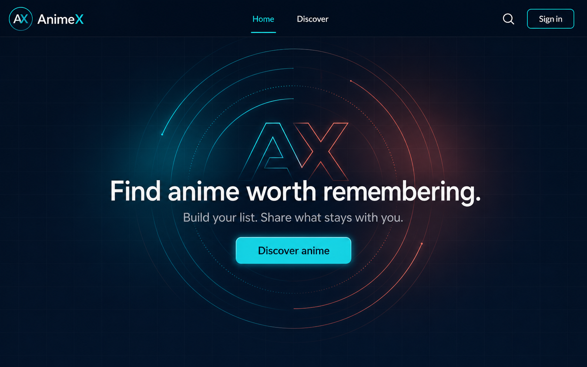

# Phase 6 Quiet Signal Landing Design

Status: APPROVED. Implementation planning pending user review.

## Approved Reference

Reference generated with native `imagegen`. `image-taste-frontend` was not used for this option.

## Product Contract

- `/` becomes the indexable public landing page.
- Signed-out and signed-in visitors both see the landing page when opening `/` directly.
- The page has one job: introduce AnimeX and send visitors to `/discover`.
- Headline: `Find anime worth remembering.`
- Supporting copy: `Build your list. Share what stays with you.`
- Primary action: `Discover anime` -> `/discover`.
- No poster, feed, statistic, badge, footer, feature strip, or secondary action appears on the page.

## Approved Architecture

Use Approach 1: a dedicated landing composition for the root route.

- The root route renders the landing feature inside `PublicAuthStateProvider`.
- It reuses `SiteHeader` with the existing primary navigation and auth-aware controls.
- It does not render `PublicShell`; this keeps the mobile bottom navigation off the landing page without changing shared shell behavior.
- The logo continues to link to `/home`.
- No header navigation item is active while the visitor is on `/`.
- The hero needs no route loader, Convex query, or client-only data. Its first render must remain server-renderable.
- Existing `/home` and other public routes keep their current shell and behavior.

## Visual Direction

- Full-height midnight navy field beneath the existing header.
- Faint geometric grid supplies depth without becoming content.
- At `768px` and wider, the centered brand signal uses live CSS rings, restrained cyan-to-coral glow, and an oversized outlined `AX` monogram.
- The text stack overlays the signal: headline, supporting copy, then the single cyan action.
- The PNG reference guides composition and mood only. The production artwork is CSS and text, not an embedded raster image.
- Use existing application tokens where they fit. Add landing-local values only for the signal artwork and ambient effects.

## Responsive Behavior

- At widths below `768px`, remove the signal rings and oversized `AX` completely.
- Keep the mobile hero centered, spacious, and vertically balanced beneath the header.
- The mobile action spans the available content width.
- Do not add a mobile bottom navigation, alternate artwork, or hidden overflow that clips focus indicators.
- At `768px` and wider, preserve the reference's layered signal composition while allowing fluid text and artwork sizing.

## Motion And Accessibility

- Use native CSS keyframes only; add no animation dependency.
- Ambient motion is limited to slow ring rotation and a subtle glow pulse.
- `prefers-reduced-motion: reduce` makes the signal fully static.
- The headline is the page's single `h1`; the supporting copy remains readable at narrow widths and zoomed layouts.
- The discover action has a clear accessible name, keyboard focus state, and sufficient contrast.
- Decorative grid, rings, glow, and oversized `AX` are hidden from assistive technology.

## Head And Favicons

- Landing metadata uses the title `AnimeX - Find anime worth remembering` and the supporting copy as its description.
- The page remains crawlable and does not add `noindex` behavior.
- Reuse the circular AnimeX `AX` mark from `public/animex-logo.svg`; do not invent or generate another logo.
- Extract a mark-only square SVG so the horizontal wordmark is never compressed into a tiny browser icon.
- Replace the existing TanStack starter atom assets with one consistent AnimeX favicon set:
  - scalable SVG favicon;
  - multi-size ICO fallback;
  - `180x180` Apple touch icon;
  - `192x192` and `512x512` manifest icons.
- Add the favicon, touch-icon, and manifest links to the shared root head so AnimeX branding applies across the application.
- Update the existing manifest's starter name, icon references, and theme colors to AnimeX values. Do not expand Phase 6 into offline or installability work.

## Validation Contract

- A focused route/component check proves `/` renders the approved copy, header, and `/discover` action for both auth states without redirecting.
- Existing public-shell checks prove `/home` and other public pages retain their bottom navigation and shell behavior.
- Build and type validation cover route generation, head metadata, and asset references.
- Browser QA covers signed-out and signed-in desktop/mobile layouts, CTA navigation, keyboard focus, reduced motion, favicon requests, and console errors.
- Visual comparison checks faithful app-native translation of the approved reference, not pixel-level duplication.

## Phase Order

- Quiet Signal Landing is Phase 6.
- Profile And Social is Phase 7.
- Notifications, Privacy, Moderation is Phase 8.

No implementation starts before the Phase 6 implementation plan is approved.
