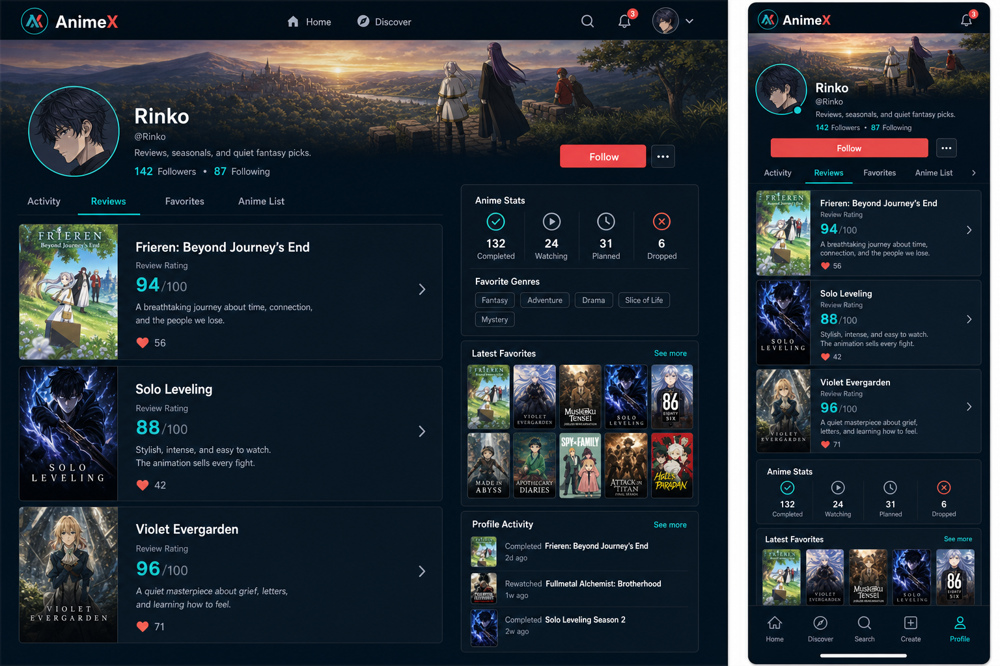
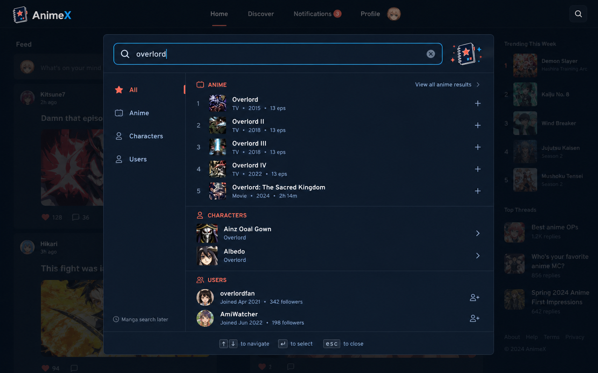
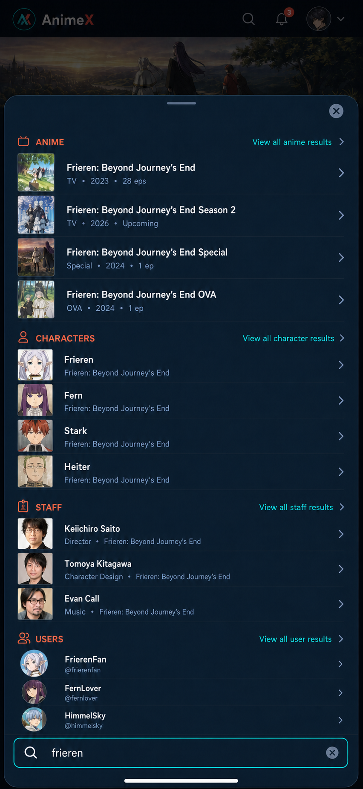

# Phase 7 User Profile, Catalog People, And Quick Search Design

Status: APPROVED. Implemented on `jeff-cx/phase-7-user-profile-quick-search`; locked visual contract shipped and validated. Current-state architecture maps live under `docs/architecture/`.

## Approved References

The references lock composition and mood. Phase 7 removes every social control, count, and footer shown in final-state profile art.

## Decisions

- Use feature verticals: `profile`, `catalog-person`, and `quick-search`.
- Deliver destinations before Quick Search entry points.
- Keep User Profiles signed-in-only.
- Add separate Public/Private Profile Visibility. Do not reuse Account-Level Default Visibility.
- Show only header identity, bio, and a privacy notice to another signed-in viewer of a Private profile.
- Use `react-easy-crop` for guided avatar and banner cropping. No package is installed during planning.
- Use the official shadcn Base UI Drawer as the mobile primitive base. Add no Vaul or Radix package.
- Treat current `.codex/agents/*.toml` files as authoritative for later subagents.

## Scope

Phase 7 includes:

- User Profile read, edit, media, visibility, stats, favorites, Reviews, and Activity.
- Character and Staff detail destinations with paginated work tabs.
- Quick Search desktop modal and mobile drawer.
- Dedicated Character, Staff, and User search-result pages.
- User full-text search projection and migration.
- Provider-neutral Character/Staff normalization and detail caching.

Phase 7 excludes:

- Follow, follower/following counts, Likes, Comments, social counts, and social activity footers.
- Followers Profile Visibility. Phase 9 owns it with Follow behavior.
- Favorite Genres, On Hold, average rating, and episodes watched in profile stats.
- Anime List profile tab.
- Manga search.
- Preset Avatar selection.
- Phase 8 content-default and bulk-visibility tools.

## Architecture

Use three focused verticals over current shared primitives:

1. `profile` owns authenticated profile routes, projections, edit/media flows, Profile Visibility, and profile content.
2. `catalog-person` owns provider-neutral Character/Staff search, detail, works, cache, and canonical routes.
3. `quick-search` owns overlay state, grouped search orchestration, dedicated result pages, and shell entry points.

Reuse:

- current public auth state and `returnTo` validation;
- current Convex profile guard;
- current Review, feed-card, favorite, and progress storage;
- current AniList client retry/error behavior;
- current Anime Detail cache/lease pattern;
- current Base UI Dialog primitives;
- current fixed poster-frame image system.

Do not:

- overload `animeDetailPeoplePages` with full person details;
- expose raw provider response shapes;
- hand-edit `routeTree.gen.ts`;
- introduce a generic search platform before Phase 7 needs it;
- change existing protected Review-route redirect behavior.

## Route Contract

| Route | Access | Contract |
| --- | --- | --- |
| `/users/:username` | Signed-in | Activity is the default tab. |
| `/users/:username?tab=activity` | Signed-in | Viewer-allowed active feed cards. |
| `/users/:username?tab=reviews` | Signed-in | Viewer-allowed source-backed Reviews. |
| `/users/:username?tab=favorites` | Signed-in | Full favorite list. |
| `/characters/:id/:slug` | Public | Overview default; Anime tab through query state. |
| `/staff/:id/:slug` | Public | Overview default; Works tab through query state. |
| `/search/characters?q=:query` | Public | Character results. |
| `/search/staff?q=:query` | Public | Staff results. |
| `/search/users?q=:query` | Signed-in | AnimeX User results. |
| `/discover?q=:query` | Public | Existing full Anime results. |

Rules:

- User Profile tab state accepts only `activity`, `reviews`, or `favorites`; invalid values replace to Activity before content queries mount.
- Signed-out User Profile and User search requests redirect to `/auth/sign-in?returnTo=<validated-relative-path>`.
- Character/Staff numeric ID is canonical identity. Slug is display-only.
- Missing or wrong Character/Staff slug redirects to the normalized canonical path.
- Result destinations close Quick Search before navigation.

## User Profile Experience

### Layout

- Keep the locked dark poster-forward cover/avatar composition.
- Header contains banner, circular avatar, display name, username, bio, and owner-only Edit Profile.
- Missing banner uses an app-native AnimeX gradient.
- Missing avatar uses the existing initials Default Avatar.
- Tabs are Activity, Reviews, and Favorites. Activity is default.
- List Progress shows completed, watching, planned, and dropped counts only.
- Latest Favorites previews the 10 most recently favorited anime and links to the Favorites tab.
- Desktop may use a supporting right column; mobile stacks the same modules.

### Profile Visibility

Add `profileVisibility` independent of the existing content-default `visibility`.

- Phase 7 values: `public` and `private`.
- Existing and new users default to `public`.
- Owner always sees the complete profile.
- Another signed-in viewer of a Public profile sees header, stats, favorites, and each Review/Activity record allowed by that record's visibility.
- Another signed-in viewer of a Private profile sees banner, avatar, display name, username, bio, and a privacy notice.
- Private profile hides stats, favorites, Reviews, and Activity from non-owners.
- User search may return Public or Private complete profiles, but returns identity fields only.
- Phase 9 may add `followers`; Phase 7 does not expose or infer it.

### Edit Profile

Use a fade-only Base UI Dialog. Do not scale the cropper container.

Fields:

- display name;
- bio;
- avatar;
- banner;
- Public/Private Profile Visibility.

Actions:

- choose, crop, replace, or remove avatar/banner;
- save text and visibility;
- cancel without mutation.

Show explicit field errors, upload progress, save progress, and retryable operation errors. Never silently keep a failed new asset.

## Profile Data

### Schema

Stage `users` changes safely:

1. Add optional `bio`, `bannerStorageId`, and `profileVisibility`.
2. Backfill missing `profileVisibility` to `public` in bounded pages.
3. Verify no completed profile is missing the field.
4. Tighten the field only after verification if the implementation plan proves that deployment order is safe.

Add `userSearchDocuments`:

- `userId`;
- normalized `searchText` from display name and username;
- `updatedAt`;
- unique index by user;
- full-text search index on `searchText`.

Update the projection on Username Completion and profile name/username edits. Never expose auth identity or email.

Reuse:

- `by_username_key` for exact canonical profile lookup;
- `by_user_favorite_at` for newest favorites;
- `userAnimeProgress` for four profile counts;
- `by_discovery_owner_newest` Review lanes;
- `by_user_active_order` for active profile activity.

### Profile Content

- Profile query returns an explicit header-only or full projection after auth and Profile Visibility checks.
- Favorites hydrate anime summaries newest-first.
- Reviews merge only allowed published lanes, newest-first.
- Activity resolves current sources through existing feed access rules, newest-first.
- Deleted/inactive Activity stays absent.
- Deleted Review Activity is not recreated from its Review source.
- Reviews, Favorites, and Activity paginate independently.

## Profile Media

### Client Crop

- Accept JPEG, PNG, or WebP source files up to 10 MiB.
- Use `react-easy-crop` for pointer, touch, wheel, keyboard, pan, and zoom behavior.
- Avatar crop: 1:1, output 512 x 512 WebP.
- Banner crop: 4:1, output 1600 x 400 WebP.
- Upload only the cropped WebP, not the source file.
- Capped cropped output: 2 MiB.

### Storage Flow

1. Owner selects a valid source and creates the crop.
2. Authenticated mutation creates a short-lived Convex upload URL.
3. Client uploads the cropped WebP and receives a storage ID.
4. Client immediately registers the storage ID as a pending profile-media upload.
5. Authenticated finalization validates owner, purpose, metadata, WebP signature, exact dimensions, and byte limit.
6. Internal mutation swaps the user reference and deletes the replaced asset only after the new reference succeeds.
7. Invalid or failed registered uploads are deleted with an explicit error.
8. Scheduled cleanup deletes expired registered pending uploads.

There is a small interruption window between direct upload completion and pending registration. Document and monitor it; do not delete unrelated storage during cleanup.

Removal clears the reference and deletes the prior owned asset. External/storage reads use bounded retries with warnings and raise the last error.

## Catalog Person

### Character

Overview may show:

- portrait and themed gradient;
- display and native name;
- description;
- age, gender, birthday, and blood type when available.

Anime tab:

- 20 items per page;
- provider popularity/relevance order;
- canonical Anime destinations;
- role metadata when available;
- automatic next-page loading plus visible Load more.

### Staff

Overview may show:

- portrait and themed gradient;
- display and native name;
- description;
- occupations, language, hometown, and active years when available.

Works tab:

- 20 items per page;
- provider popularity/relevance order;
- canonical Anime destinations;
- staff role metadata when available;
- automatic next-page loading plus visible Load more.

Omit unavailable optional metadata. Show an explicit empty state when an entire section is absent.

### Provider Boundary And Cache

- Server-only provider adapter validates strict Character/Staff search, detail, and work schemas.
- UI contracts use provider-neutral names.
- Detail and work-page caches use separate records from Anime Detail people edges.
- Cache TTL is 24 hours.
- Lease ownership, expiry, retry, and clear-error rules follow current Anime Detail cache behavior.
- Missing, rate-limited, invalid, or unavailable provider data fails explicitly. No stale fallback.
- Existing Anime Detail Character, Staff, and Japanese voice-actor cards link to the new destinations.

## Quick Search

### Search Contract

- Trim input.
- Minimum 2 characters; maximum 100.
- Debounce 300 ms.
- One provider request returns Anime, Characters, and Staff.
- Each group returns at most five normalized rows.
- Signed-in Users come from Convex full-text search, also capped at five.
- Signed-out search omits the User request and group.
- Manga is absent.
- No persistent provider search cache; use TanStack Query client caching.

Provider failure shows a clear Anime/Characters/Staff error with retry. An independently successful User group may remain visible.

### Desktop

- Open from the header Search control for signed-out and signed-in users.
- Use the locked wide Base UI Dialog shell.
- Search field stays at the top.
- Results use grouped semantic lists, View all links, and right chevrons.
- Remove category rail, add/favorite actions, Follow actions, and inline social controls.

### Mobile

- Open from the bottom Search tab for signed-out and signed-in users.
- Build a local primitive from the official shadcn Base UI Drawer.
- Use `showSwipeHandle` and downward swipe dismissal.
- Results use `flex-1 overflow-y-auto`.
- Search field stays in the footer above the safe area and software keyboard.
- Do not use `h-full` on the scroll region.
- Keep `body` positioned relative for iOS Safari overlay behavior.
- Use Base UI render props, not Radix `asChild`.

No Vaul or Radix production dependency is allowed for the Drawer.

### Interaction And Accessibility

- Focus search on open.
- Arrow keys move through results; Enter opens the active result.
- Escape closes; focus returns to the trigger.
- Mobile also supports close button, backdrop, and downward swipe.
- Dialog/Drawer has an accessible title and description.
- Keep modal focus containment, semantic result lists, status announcements, visible focus, reduced motion, and touch-sized controls.
- Result click closes before navigation.
- Cover prompt, loading, partial success, empty, error, retry, end, dismissal, and rapid-query-change states.

## Dedicated Search Pages

- Reuse the Reviews-page shell geometry, not Review business logic.
- Keep query in URL.
- Prompt below two characters.
- Use 20-item pages.
- Use automatic next-page loading and keep a visible Load more control.
- Deduplicate by canonical entity ID.
- Show explicit loading, empty, error, retry, and end states.
- Character/Staff pages call the provider through normalized server functions.
- User page calls the authenticated Convex full-text search query.
- Anime continues through Discover.

## Data Flows

### Profile Read

- Entry: `/users/:username`.
- Input: username, tab, authenticated viewer.
- Validation: auth complete, normalized username, allowed tab.
- Transform: exact user lookup, Profile Visibility decision, content-lane filtering, UI projection.
- Storage: users, progress, favorites, Reviews, feed cards, Anime summaries.
- External calls: none after stored image URLs resolve.
- Retry: normal Convex reactive query behavior; no silent substitution.
- Error: sign-in redirect, not found, unavailable, or explicit query error.
- Output: header-only or full profile.
- Owner: `profile`.

### Profile Edit And Media

- Entry: owner Edit Profile dialog.
- Input: text, Profile Visibility, cropped asset.
- Validation: auth owner, text bounds, source/cropped media contract, stored media signature/dimensions.
- Transform: normalized text/search projection and owned media reference.
- Storage: users, user search projection, Convex Storage, pending uploads.
- External calls: direct Convex upload endpoint and stored blob read.
- Retry: bounded storage retries with warning; raise last error.
- Error: field, crop, upload, validation, save, or cleanup error.
- Output: updated current profile.
- Owner: `profile`.

### Catalog Person

- Entry: Character/Staff result or Anime Detail people card.
- Input: kind, canonical ID, slug, tab, cursor.
- Validation: kind, positive numeric ID, normalized slug, strict provider response.
- Transform: provider response to stable Character/Staff/detail/work projection.
- Storage: person detail, work pages, and leases.
- External calls: provider GraphQL.
- Retry: existing AniList client policy.
- Error: not found, rate limit, invalid provider data, unavailable cache refresh.
- Output: canonical detail or work page.
- Owner: `catalog-person`.

### Quick Search

- Entry: desktop Search or mobile Search tab.
- Input: normalized query and auth state.
- Validation: 2-100 characters.
- Transform: parallel provider groups plus optional User group into destination-ready rows.
- Storage: user search projection only; provider results stay client-cached.
- External calls: one provider GraphQL request and optional Convex query.
- Retry: provider client policy plus explicit user retry.
- Error: isolated provider or User group error; never fake data.
- Output: capped grouped results or dedicated-page navigation.
- Owner: `quick-search`.

## Migration And Rollout

Order:

1. Add optional profile fields, Profile Visibility, user-search projection, cache tables, and required indexes.
2. Deploy Convex schema/functions.
3. Backfill and verify Profile Visibility and user-search documents.
4. Ship Profile destination and edit/media flow.
5. Ship Character/Staff detail destinations and link Anime Detail people cards.
6. Ship dedicated search pages.
7. Ship Quick Search modal/drawer.
8. Replace shell Search links and add signed-in Profile destinations.

Quick Search entry points stay disabled until every result destination works.

Rollback:

- Restore shell Search navigation first.
- Disable new route entry points.
- Keep additive fields, projection rows, and cache rows; they are inert without readers.
- Never delete prior media before a replacement reference commits.
- Do not rewrite stored content visibility or Followers values.

## Validation

Focused checks:

- profile auth, tab, Profile Visibility, projection, edit, and media lifecycle;
- Character/Staff normalization, cache, canonical redirect, pagination, and error contracts;
- Quick Search query validation, group caps, signed-out User omission, destination links, and stale-response handling;
- user-search backfill and verification.

Full gates:

- `pnpm exec tsc --noEmit`
- `pnpm test`
- `pnpm build`
- `pnpm exec fallow audit --base <resolved-base> --format json --quiet`
- React Doctor on changed React files
- `pnpm exec convex dev --once` after Convex changes

Browser QA:

- 390 px and 1280 px;
- signed-out and signed-in;
- owner, Public profile viewer, and Private profile viewer;
- desktop keyboard and mobile touch/drawer behavior;
- avatar/banner crop, replace, remove, failure, and retry;
- Character/Staff tabs and pagination;
- Quick Search prompt, loading, partial success, empty, error, retry, dismissal, and navigation;
- console and network errors.

Use real local Convex/provider flows when practical. Add no coverage-only tests or fragile mocks.

## Documentation

Keep these current-state surfaces aligned:

- `CONTEXT.md`
- `PLAN.md`
- `TODO.md`
- `docs/superpowers/specs/2026-07-16-phase-7-9-feature-sequencing.md`
- locked visual references under `docs/visual`

Remove stale Phase 7 references to public profiles, singular Review Tab, profile social controls/counts, Favorite Genres, desktop-only Quick Search, and mobile Discover routing.

## Implementation References

- shadcn Base UI Drawer: <https://ui.shadcn.com/docs/components/base/drawer>
- Convex uploads: <https://docs.convex.dev/file-storage/upload-files>
- Convex metadata: <https://docs.convex.dev/file-storage/file-metadata>
- Convex deletion: <https://docs.convex.dev/file-storage/delete-files>
- Convex full-text search: <https://docs.convex.dev/search/text-search>
- Convex pagination: <https://docs.convex.dev/database/pagination>
- `react-easy-crop`: <https://github.com/ValentinH/react-easy-crop>

The implementation plan is `docs/superpowers/plans/2026-07-17-phase-7-user-profile-catalog-people-quick-search.md`. Implementation and review are complete; production deploy, push, merge, and unexercised browser fixtures remain outside this closure.

## Closure validation

- Final full suite: 122 passed + 2 skipped files / 889 passed + 3 skipped tests; focused header/Quick Search suite: 5 files / 40 tests.
- TypeScript, build, Fallow (0 introduced dead code/complexity/duplication), and Convex dev deploy `quiet-husky-184` pass. React Doctor is 62 with one inherited Discover ref mutation.
- Desktop/tablet/mobile core browser flows pass. Landing and signed-out auth Search recheck stayed on route, opened one dialog/searchbox, and logged zero console errors.
- Code reviewer PASS after commit `5178706`.

Verification gaps, not implementation blockers:

- [x] Second-account private-profile browser fixture.
- [x] Real media upload/crop/remove browser flow.
- [x] Failure injection through the Storage upload lane.
- [ ] Deep pagination Load more browser flow.
